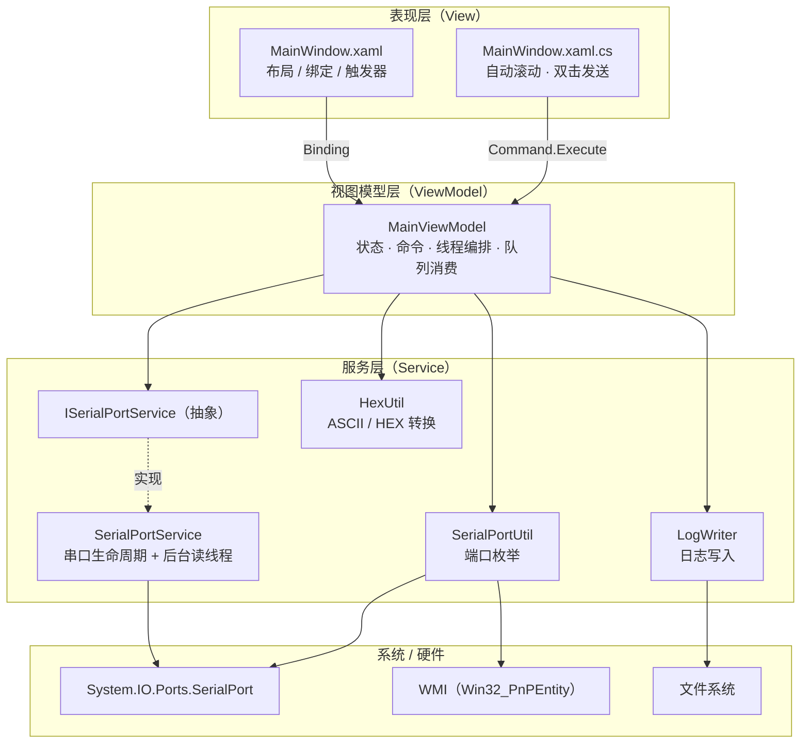
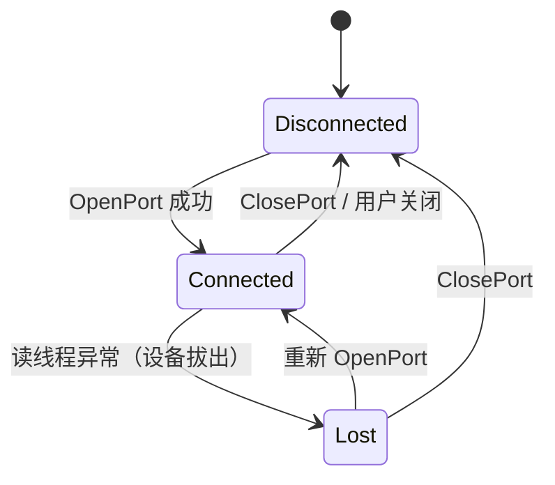
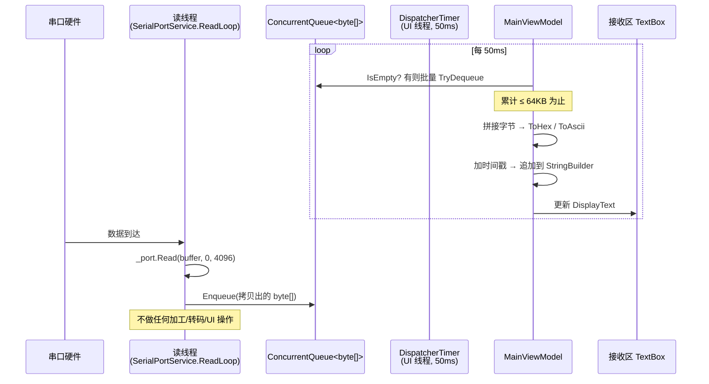
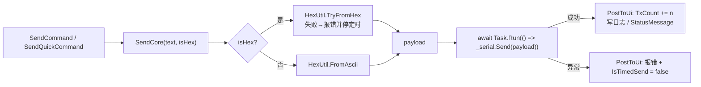
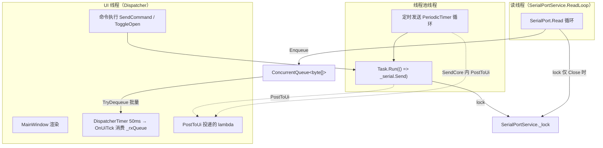

# SerialAssistant 技术架构文档

> 版本：v1.0 · 适用代码基线：`net8.0-windows`
> 配套文档：[README.md](../README.md)

---

## 1. 概述

SerialAssistant 是一个 Windows 桌面串口调试工具，用于串口数据的收发、调试与记录。

设计目标：

1. **响应性**：串口 I/O 与 UI 线程彻底解耦，高吞吐接收时界面不卡顿、不丢数据。
2. **简单性**：单窗口、单 ViewModel，不引入 DI 容器与消息总线，保持调用链直观可读。
3. **安全性**：定时发送、异步发送、连接状态切换等并发路径具备明确的线程与所有权约定。

代码规模约 1000 行，核心逻辑集中在 `MainViewModel`（约 760 行）与 `SerialPortService`（约 110 行）。

---

## 2. 技术栈与依赖

| 依赖 | 版本 | 用途 |
| --- | --- | --- |
| .NET | 8.0（`net8.0-windows`） | 目标框架 |
| WPF | 随 .NET 8 | UI 框架（`UseWPF=true`，`OutputType=WinExe`） |
| CommunityToolkit.Mvvm | 8.4.2 | MVVM 基类、源生成器（`[ObservableProperty]` / `[RelayCommand]`） |
| System.IO.Ports | 10.0.11 | 串口读写 |
| System.Management | 8.0.0 | WMI 查询串口设备友好名 |

工程属性：`Nullable=enable`、`ImplicitUsings=enable`。

---

## 3. 整体架构

采用经典的三层 MVVM 分层，各层职责单向依赖（View → ViewModel → Service → 系统 API）。



### 各层职责

| 层 | 文件 | 职责 |
| --- | --- | --- |
| 表现层 | `App.xaml` | 应用入口，`StartupUri="MainWindow.xaml"` |
| | `MainWindow.xaml` | 纯声明式布局：串口设置、接收区、发送区、状态栏；通过 `Binding` 与 VM 通信 |
| | `MainWindow.xaml.cs` | 仅保留无法用绑定表达的视图逻辑：接收区 `TextChanged` 自动滚动、快捷指令列表双击发送 |
| 视图模型层 | `ViewModels/MainViewModel.cs` | 唯一 VM。持有全部 UI 状态、命令、串口服务引用；负责线程编排、接收队列消费、定时发送循环、日志开关、状态机 |
| 服务层 | `Services/Interface/ISerialPortService.cs` | 串口服务抽象，隔离具体实现，便于替换与测试 |
| | `Services/SerialAssistant/SerialPortService.cs` | 串口打开/关闭/写、后台读线程、错误上报 |
| | `Services/SerialAssistant/SerialPortUtil.cs` | 静态工具：枚举系统串口 |
| | `Services/SerialAssistant/HexUtil.cs` | 静态工具：ASCII ↔ HEX 转换 |
| | `Services/SerialAssistant/LogWriter.cs` | 线程安全的文件日志写入 |

> 说明：本项目未使用依赖注入。`MainViewModel` 直接 `new SerialPortService()`。在只有一个消费者、没有可替换实现需求的场景下，DI 容器属于净增复杂度。

---

## 4. 核心数据模型

### 4.1 `SerialPortInfo`（端口信息）

```csharp
public sealed class SerialPortInfo
{
    public string PortName;      // "COM3"
    public string Description;   // "USB-SERIAL CH340"
    public string Display => 有描述且不同于端口名 ? $"{PortName}-{Description}" : PortName;
}
```

`Display` 为只读计算属性，直接作为下拉框的 `DisplayMemberPath`，避免在 XAML 里写 `MultiBinding`。

### 4.2 `SerialSetting`（串口参数）

承载一次「打开串口」所需的全部参数，作为 `Open(SerialSetting)` 的入参，是可变的 POCO：

```csharp
PortName / BaudRate / DataBits / Parity / StopBits / Handshake
```

VM 侧对应 6 个 `[ObservableProperty]` 字段（`SelectedBaudRate` 等），打开时由 `ParseBaudRate()` / `ParseParity()` / `ParseStopBits()` / `ParseHandshake()` 解析为强类型枚举，非法值回退默认值。

### 4.3 `SerialPreset`（参数预设）

不可变的预设组合（`Name` + 四个参数），`OnSelectedPresetChanged` 一次性回填到各 `Selected*` 属性，实现「一键套用」。

### 4.4 `SerialConnectionState`（连接状态）



| 状态 | 含义 | UI 表现 |
| --- | --- | --- |
| `Disconnected` | 未连接 | 灰色指示灯，「打开串口」 |
| `Connected` | 已连接 | 绿色指示灯，设置区禁用，允许发送 |
| `Lost` | 设备失联（非用户主动关闭） | 红色指示灯，「设备已断开」 |

`ConnectionState` 通过 `[NotifyPropertyChangedFor]` 联带到 `IsConnected`、`CanEditSettings`、`OpenButtonText`、`ConnectionText`，并用 `[NotifyCanExecuteChangedFor(nameof(SendCommand))]` 联动发送命令的可用性。

---

## 5. 关键机制

### 5.1 串口枚举

`SerialPortUtil.GetPorts()` 采用**双源合并**策略：

1. **WMI 源**（主）：`SELECT Caption FROM Win32_PnPEntity WHERE Caption LIKE '%(COM%'`
   从形如 `USB-SERIAL CH340 (COM3)` 的 Caption 中切分出 `COM3` 与描述 `USB-SERIAL CH340`。
2. **System.IO.Ports 源**（补充）：`SerialPort.GetPortNames()` 兜底 —— WMI 可能因权限/驱动异常遗漏端口（整个 WMI 块被 `try/catch` 静默包裹）。

合并规则：以端口名为键做 `HashSet` 去重，WMI 源优先（带描述），`GetPortNames` 只补齐缺失项。这样既能拿到友好名，又不漏端口。

`RefreshPorts` 命令刷新前先记录 `SelectedPort?.PortName`，刷新后 `FindPort(keep)` 还原选择，避免下拉框被清空。

### 5.2 接收线程模型（生产者-消费者）

这是本项目最核心的并发设计。串口读线程与 UI 线程通过 `ConcurrentQueue<byte[]>` 解耦，**读线程只入队，UI 线程定时批量消费**。



要点：

- **读线程（`ReadLoop`）**：`new Thread`（非线程池，避免长时间占用池线程），`IsBackground = true`。用 4096 字节缓冲区循环 `Read`，`ReadTimeout = 200ms` 使无数据时的 `TimeoutException` 成为正常轮询节奏。读到 `n > 0` 时 `buffer.AsSpan(0, n).ToArray()` **拷贝**后入队（否则缓冲区复用会污染数据）。
- **入队零加工**：`OnDataReceived` 仅 `_rxQueue.Enqueue(data)`，保证读线程永远不被 UI 逻辑拖慢。
- **UI 消费**：`DispatcherTimer`（`DispatcherPriority.Background`，50ms ≈ 20fps）触发 `OnUiTick`，批量出队拼接。
- **背压保护**：`MaxBytesPerTick = 64KB`。单次 tick 最多消费 64KB，剩余留到下一 tick，避免突发数据把 UI 线程长时间占住导致界面无响应。
- **拼接优化**：使用内部 `ListBuilder`（自增长 `byte[]` + `Buffer.BlockCopy`），替代 `List<byte>.AddRange` 的多次扩容。

选 `DispatcherTimer` 而非 `Task.Delay` 循环的原因：tick 天然运行在 UI 线程，无需额外编组；且定时器停摆不会泄漏后台任务。

### 5.3 显示裁剪

`AppendToDisplay` 维护一个 `StringBuilder _display` 作为显示区唯一数据源：

- 每批数据追加一行（`Environment.NewLine` 分隔，天然形成「一批一行」）。
- 超过 `MaxDisplayChars = 256KB` 时，从头部裁剪只保留尾部 256KB，整体替换一次 `DisplayText`。

先追加后判断、只在越界时整体替换，避免每次 tick 都做字符串拼接分配。代价是显示区最多保留 256K 字符（超出部分不可回滚，属预期行为）。

### 5.4 发送路径与异步化



关键决策：

- **`await Task.Run(...)`**：`SerialPort.Write` 受 `WriteTimeout = 2000ms` 约束，会阻塞调用线程。放到线程池上执行后 `await` 释放 UI 线程，避免界面冻结最长 2 秒。
- **异常可捕获**：`Task.Run` 把委托内异常存入 `Task.Exception`，`await` 时用 `ExceptionDispatchInfo` 在原上下文重抛，因此 `catch (Exception ex)` 能拿到原始 `TimeoutException` / `IOException`（不是 `AggregateException`）。**前提是必须 `await`**；用 `.Wait()` / `.Result` 会包成 `AggregateException`。
- **命令签名**：`private Task Send() => SendCore(...)`（返回 `Task` 而非丢弃），使异常能沿命令管道向上传递，`[RelayCommand]` 会生成 `IAsyncRelayCommand`。
- **`CanSend()`**：`=> IsConnected`，通过 `[RelayCommand(CanExecute = nameof(CanSend))]` + `NotifyCanExecuteChangedFor` 实现连接状态驱动的按钮禁用。
- **写并发串行化**：异步化后 UI 线程会被释放，连点发送可产生并发 `Write`。`SerialPortService.Send` 用 `lock (_lock)` 串行化写入，与 `Close()` 共用同一把锁，避免「写进行中关端口」。

`StatusMessage` 语义提醒：它是**单槽当前状态**而非事件流。同步路径下连续赋值只有最后一次可见（WPF 只绘制最终值），需要留痕请走日志文件或接收区。

### 5.5 定时发送（VM 内联实现）

定时发送**未**抽象为独立服务，而是内联在 VM 中（`_timeCts` + `_timeLoop`）。理由：唯一消费者是 `MainViewModel`，独立服务需引入事件、状态枚举、payload 结构、`IAsyncDisposable` 等抽象税，收益可忽略。

```csharp
private void StartTimedSend()
{
    // 1. 校验一次内容，避免定时器空转
    if (IsSendHex && !HexUtil.TryFromHex(SendText, out _, out _)) { ... return; }

    // 2. 局部快照：cts / token / text / interval 全部捕获为局部变量
    var cts = new CancellationTokenSource();
    var token = cts.Token;

    // 3. 原子换手：换入新的，取走并取消旧的
    Interlocked.Exchange(ref _timeCts, cts)?.Cancel();

    // 4. 后台线程跑 PeriodicTimer 循环
    _timeLoop = Task.Run(async () =>
    {
        try
        {
            using var timer = new PeriodicTimer(TimeSpan.FromMilliseconds(interval));
            while (await timer.WaitForNextTickAsync(token))
                await SendCore(text, isHex);
        }
        catch (OperationCanceledException) { }
        finally { cts.Dispose(); }   // 谁创建谁释放，且只碰局部 cts
    });
}

private void StopTimedSend()
    => Interlocked.Exchange(ref _timeCts, null)?.Cancel();   // 非阻塞、不 Dispose、不 Wait
```

三条硬约束（缺一不可）：

1. **循环必须跑在后台线程**：`SerialPort.Write` 有 2000ms 写超时，跑 UI 线程会冻结界面。
2. **CTS 必须快照到局部变量**：不能每个 tick 读共享字段 `_timeCts`。否则 `Stop` 把字段置空/换新后，旧循环会读到 `null`（NRE）或读到**新** CTS（旧循环永不停止，取消新 CTS 却杀掉旧循环）。
3. **绝不在 UI 线程无界 `Wait()`**：若 UI 线程等待的任务本身在等 UI 线程，即为永久挂起。仅在 `Dispose` 退出时做限时 `Wait(500)`。

#### `Interlocked.Exchange` 换手的所有权模型

`Start` 与 `Stop` 都是「原子换手」形式，对称且只有一处原子点：

```csharp
Interlocked.Exchange(ref _timeCts, cts)?.Cancel();   // Start：换入新会话，取走旧会话
Interlocked.Exchange(ref _timeCts, null)?.Cancel();  // Stop：换入 null，取走当前会话
```

这解决了旧写法（「先 `Cancel()` 再 `_timeCts = null`」）的三个问题：

- **丢失更新**：Stop 清空字段时可能覆盖 Start 刚写入的新会话 → 产生永远停不掉的幽灵定时器。
- **并发二次 Stop**：一方读到的 CTS 已被另一方 `Dispose` → `Cancel()` 抛 `ObjectDisposedException`。
- **Dispose 与 token 重注册竞争**：`WaitForNextTickAsync(token)` 每 tick 重新注册 token，撞上 `Dispose` 会异常或丢取消。

配套规则：**循环 `finally` 只能操作本次会话捕获的局部变量，绝不能碰共享字段 `_timeCts`**。因为循环退出的时刻可能晚于下一次 `Start`（最长晚 2s，卡在写超时），此时字段已指向新会话，释放字段会误 `Dispose` 新会话的 CTS，导致定时静默死掉。若确需在 `finally` 清字段，必须用 `Interlocked.CompareExchange(ref _timeCts, null, cts)` 只清自己。

另一条规则：**`Stop` 绝不 `Dispose`、绝不 `Wait`**，因为 `Stop` 可能从后台发送失败回调内部被调用，同步等待会自锁。

`OnIsTimedSendChanged` / `OnIntervalMsChanged` 触发 Start/Stop；间隔变更直接重启（`Start` 内部的换手已隐含「停旧的」），无需先显式 Stop。

> 残留限制：停止时若循环正卡在 `Write` 中，最多会多发一帧（最长 2s），这是 `SerialPort.Write` 的固有行为。

### 5.6 UI 线程编组 `PostToUi`

```csharp
private void PostToUi(Action action)
{
    if (_ui.CheckAccess()) action();      // 已在 UI 线程 → 内联执行
    else _ui.InvokeAsync(action);         // 后台线程 → 投递到 UI 队列
}
```

- `Dispatcher.CurrentDispatcher` 在 VM 构造时（UI 线程）捕获到 `_ui`。
- `CheckAccess()` 为真时**内联同步执行**，避免 `InvokeAsync` 自投递引起的重排序（否则 `TxCount` 等更新会滞后于调用点后续代码）。
- 后台路径使用 `InvokeAsync`（fire-and-forget）而非 `Invoke`，避免阻塞后台线程，也避免「UI 等后台、后台等 UI」的死锁闭环。

> 已知风险：`InvokeAsync` 返回的 `DispatcherOperation` 无人 `await`，lambda 内异常会静默丢失。

### 5.7 错误处理与异常边界

`SerialPortService` 内部**吞掉**异常并通过 `ErrorOccurred` 事件上报，VM 侧 `OnSerialError`（已由 `PostToUi` 编组回 UI 线程）按上下文分流：

| 场景 | 判定条件 | 处理 |
| --- | --- | --- |
| 打开失败 | `_opening == true` | `StatusMessage = 错误原因`，状态保持未连接 |
| 通信中断 | `ConnectionState == Connected` | 走 `ForceDisconnect`，状态置 `Lost`，提示「设备可能已断开」 |
| 关闭余波 | 其余情况 | 静默丢弃（关闭端口时读线程抛出的异常无需打扰用户） |

- `SerialPortService.Open` 用 `try/catch` 包裹 `Open()` + `DiscardInBuffer()`，失败即 `ErrorOccurred?.Invoke(ex.Message)` 并 `return`。
- `ReadLoop` 中 `TimeoutException` 静默忽略（正常轮询），其他异常上报后 `break` 退出循环。
- `Close()` 会 `Join` 读线程（超时 `ReadTimeout + 100`），未退出则上报「读线程未正常退出」。

### 5.8 日志写入

`LogWriter` 用 `lock` 保护单个 `StreamWriter`，采用**延迟 Flush**：

- 每次 `Write` 计数 `_pending`，累计 20 条才 `Flush()` 一次，降低磁盘 I/O 频率。
- `Stop()` / `Dispose()` 会先 `Flush` 再 `Dispose`，保证退出不丢尾部数据。
- 日志路径：`我的文档\SerialAssistantLogs\SerialLog_yyyyMMdd_HHmmss.txt`，`append: true`、`Encoding.UTF8`、`AutoFlush = false`。
- 日志行格式：`[时间] <- 接收内容` / `[时间] -> 发送内容`。
- 开启失败（磁盘/权限）时回滚：`_logger.Stop()` + `IsLogging = false`（受 `_suppressLogCallback` 标志保护，防止回调重入）。

### 5.9 HEX / ASCII 转换

`HexUtil` 是纯静态无状态工具：

| 方向 | 方法 | 说明 |
| --- | --- | --- |
| 发送 | `FromAscii(text)` | `Encoding.ASCII.GetBytes`，非 ASCII 变 `?` |
| 发送 | `TryFromHex(text, out bytes, out error)` | 先剥离分隔符，再按 2 字符 1 字节解析 |
| 接收 | `ToAscii(bytes)` | `Encoding.ASCII.GetString` |
| 接收 | `ToHex(bytes)` | `BitConverter.ToString` 后把 `-` 换成空格 |

`TryFromHex` 的容错：支持空格/制表符/换行/逗号/短横/冒号分隔与 `0x` 前缀；校验「字符数为偶数」「每两位为合法十六进制」；失败通过 `out error` 返回中文原因，**不抛异常**（发送框输入错误属正常用户操作）。

---

## 6. 线程模型总览



线程安全要点汇总：

| 共享资源 | 保护方式 |
| --- | --- |
| `_rxQueue` | `ConcurrentQueue` 自身线程安全 |
| `_timeCts` | `Interlocked.Exchange` 原子换手 |
| 显示/统计/状态属性 | 只在 UI 线程写（经 `PostToUi` 编组） |
| `SerialPort` 实例 | `SerialPortService._lock`（写与关闭互斥） |
| `LogWriter._writer` | `LogWriter._lock` |

---

## 7. 已知技术债与改进建议

| 优先级 | 问题 | 位置 | 建议 |
| --- | --- | --- | --- |
| 高 | `Dispose()` 无调用方，退出时串口/日志未释放 | `MainViewModel.Dispose` | 在 `MainWindow.Closing` 挂接，或覆写 `OnClosed` |
| 高 | `Send` 在端口未打开时返回 `0` 不抛异常 → 调用方误判成功（状态栏显示已发送、`TxCount` 递增，实际未发出） | `SerialPortService.Send` | 改为抛异常或返回 `bool` |
| 中 | 写超时未按设备异常处理，仅停定时发送 | `MainViewModel.SendCore` | 走 `ForceDisconnect`，必要时关端口重开（超时后输出缓冲可能残留，下次写会立即再超时） |
| 中 | `_readLoopThread!` 空引用隐患 | `SerialPortService.Close` | 空值检查 |
| 中 | `PostToUi` 的 `InvokeAsync` 异常静默丢失 | `MainViewModel.PostToUi` | lambda 内包 try/catch 或 await 返回的 `DispatcherOperation` |
| 低 | ASCII 转换不支持中文/多字节编码 | `HexUtil` | 改为可配置编码（`GBK` / `UTF-8`），只需改 `FromAscii` / `ToAscii` 两处 |
| 低 | 快捷指令与预设未持久化 | `MainViewModel` | 落 JSON 到 `%AppData%` |
| 低 | `MainViewModel` 职责偏重（约 760 行） | `ViewModels/MainViewModel.cs` | 如需继续扩展，可按「串口 / 发送 / 定时 / 日志」拆分为子 VM 或 partial class |

---

## 8. 扩展点设计

| 需求 | 扩展方式 |
| --- | --- |
| 支持中文/UTF-8 收发 | 修改 `HexUtil.FromAscii` / `ToAscii` 的 `Encoding`；或抽出 `IEncoder` 供界面切换 |
| 更换串口实现（如虚拟串口模拟器） | 实现 `ISerialPortService` 并在 VM 中替换实例 |
| 收发数据解析（如 Modbus 组帧） | 在 `OnUiTick` 消费点之后插入解析管线，或新增服务层组件 |
| 多串口同时调试 | 将 `MainViewModel` 按端口实例化，`MainWindow` 改为 `TabControl` 承载多个 VM |
| 配置文件持久化 | 引入 `%AppData%\SerialAssistant\settings.json`，在构造/退出时读写 |

---

## 9. 关键常量速查

| 常量 | 值 | 位置 | 含义 |
| --- | --- | --- | --- |
| `UiRefreshIntervalMs` | 50 | MainViewModel | UI 批量刷新间隔（约 20fps） |
| `MaxBytesPerTick` | 64 KB | MainViewModel | 单次消费上限（背压保护） |
| `MaxDisplayChars` | 256 KB | MainViewModel | 显示区字符上限 |
| `MinSendIntervalMs` | 10 | MainViewModel | 定时发送最小间隔 |
| `ReadTimeoutMs` | 200 | SerialPortService | 读超时（构成轮询节奏） |
| `WriteTimeout` | 2000 | SerialPortService | 写超时（界面阻塞上界） |
| `ReadBufferSize` | 8192 | SerialPortService | 串口接收缓冲区 |
| 读缓冲区 | 4096 | SerialPortService.ReadLoop | 单次 `Read` 缓冲区 |
| 日志 Flush 阈值 | 20 条 | LogWriter | 累计 20 条 Flush 一次 |
